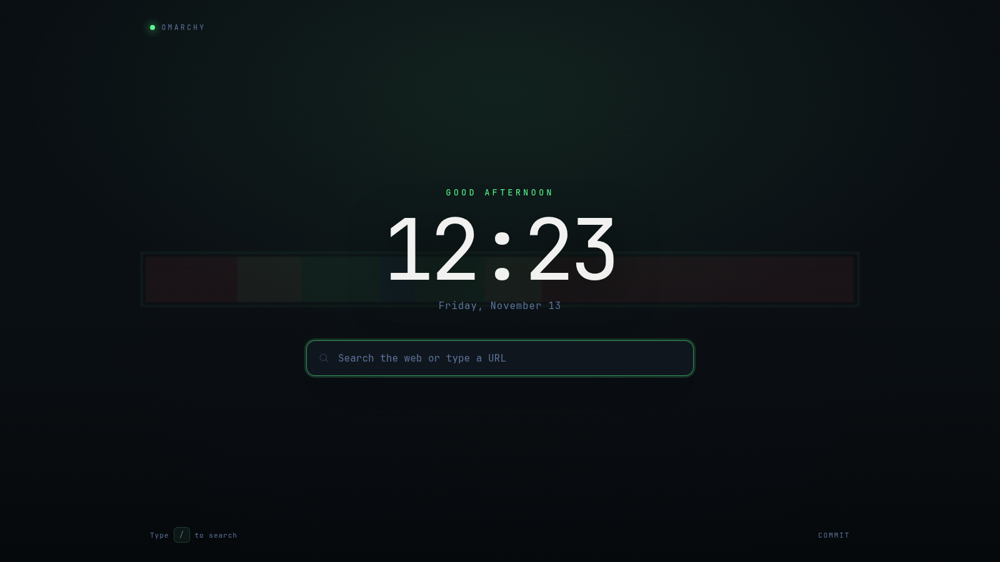

# Omarchy New Tab

A minimal, theme-aware new tab page for Chromium-based browsers, packaged as
an Omarchy shell service plugin. It shows a clock, greeting, date, search field,
optional quick links, and a background picker over your active Omarchy palette.
It can use the current theme's wallpapers or images you add yourself.



## Requirements

- Omarchy with the Omarchy shell (Quattro or newer).
- **Chromium**, **Helium**, or **Brave** as the default web browser.

Firefox, Zen, and LibreWolf use a different extension format and are not
supported. Google Chrome, Microsoft Edge, and Vivaldi are also not supported
because branded Chromium builds no longer honor `--load-extension`.

## Install

```sh
omarchy plugin add https://github.com/icameheretodance/omarchy-newtab.git --enable
```

When the shell loads the service, it:

1. Detects the default browser with `xdg-settings`.
2. Adds this plugin's extension folder to that browser's startup flags,
   preserving every other flag and `--load-extension` path.
3. Sends a desktop notification asking you to restart the browser.
4. Generates `colors.css`, `theme-name.txt`, `wallpapers.json`, and
   content-addressed copies of the active theme's wallpapers.

Restart the browser once so it picks up the extension. If the default browser
is not supported, nothing is changed and a one-time notification explains why.
The plugin checks again on the next shell start, so it starts working after you
switch to a supported default browser.

### Manual install

The extension lives at
`~/.config/omarchy/plugins/dance.newtab/extension/browser`. For Chromium, Helium, or
Brave, append it to the existing `--load-extension` value in the matching file:

- `~/.config/chromium-flags.conf`
- `~/.config/helium-browser-flags.conf`
- `~/.config/brave-flags.conf`

```ini
--load-extension=/usr/share/omarchy-webapp-theme/extension,/home/you/.config/omarchy/plugins/dance.newtab/extension/browser
```

Commas separate extension paths. Quit the browser completely before restarting
it, otherwise the old process keeps the old flags.

## What it changes

| Path | Change |
| --- | --- |
| `~/.config/chromium-flags.conf` | Adds/removes only this extension's path |
| `~/.config/helium-browser-flags.conf` | Adds/removes only this extension's path |
| `~/.config/brave-flags.conf` | Adds/removes only this extension's path |
| `.../extension/browser/colors.css` | Generated palette (untracked) |
| `.../extension/browser/theme-name.txt` | Generated theme label (untracked) |
| `.../extension/browser/wallpapers.json` | Available theme wallpapers (untracked) |
| `.../extension/browser/wallpaper-*` | Content-addressed wallpaper copies (untracked) |
| `.../extension/browser/.theme-fingerprint` | Sync bookkeeping (untracked) |

Each flags-file edit creates a timestamped backup next to it
(`<file>.bak.<timestamp>`) and never touches other flags. If the browser is
running, it must be restarted for the change to apply.

The only extension permission is `search`. The extension has no host
permissions, makes no analytics or network requests of its own, and sends
searches through the browser's own search provider.

The service only reads local Omarchy theme files. Palette values are validated
as hex colors before they reach the extension, generated CSS is fetched and
filtered through a fixed property allowlist instead of being linked as a
stylesheet, and theme wallpaper copies are limited to 24 recognized images,
50 MiB each and 100 MiB total. Custom backgrounds are limited to 6 raster
images, 20 MiB each, and stay in the browser profile's IndexedDB. SVG uploads
are rejected.

### Dependencies and privileges

- Bash plus standard Arch userland tools: `xdg-settings`/`xdg-mime`
  (`xdg-utils`), `pgrep` (`procps-ng`), coreutils, `sed`, and `grep`.
- `omarchy-notification-send` for notifications, with `notify-send` as a
  fallback.
- Everything runs as your user, with no root access, network access, or
  remote build step.
- No second Quickshell process is started; the service runs inside
  `omarchy-shell`.
- The installer writes only the flags files and generated extension assets
  listed above.

## How it works

- `Service.qml` runs `scripts/install` at load, then watches `theme.name`,
  `theme/colors.toml`, and the `background` symlink.
- `scripts/sync-theme` renders the palette, lists the current theme's
  backgrounds in `wallpapers.json`, and copies them into the extension with
  content-addressed names. A fingerprint guard makes repeat runs cheap, and
  stale generated wallpapers are removed.
- The page re-fetches `colors.css`, `theme-name.txt`, and `wallpapers.json`
  every 30 seconds while it is visible, so an already-open new tab picks up
  theme changes. Theme-set changes arrive through the file watcher; a
  60-second check also catches wallpaper-only changes.
- Only the default browser is configured automatically. If you change the
  default while the shell is running, disable and re-enable the plugin, or run
  `~/.config/omarchy/plugins/dance.newtab/scripts/install` yourself.

## Settings

Use the button in the top-right corner to open the **Display**, **Links**, and
**Background** tabs. Display controls the clock, date, greeting, theme name,
12/24-hour time, seconds, and reduced motion. Links manages quick links.
Background provides the wallpaper picker, dim, and blur controls.
Changes apply immediately and can be restored with **Reset to defaults**.

### Quick links

**Show quick links** is off by default. When enabled, it shows up to 12 custom
sites below the search field. The name is optional and falls back to the site's
hostname. Only `http` and `https` URLs are accepted; duplicates are ignored.

### Background

The background picker offers **System** (the active Omarchy wallpaper),
**None**, up to 24 wallpapers bundled with the active theme, and custom images.
Custom images are stored locally in IndexedDB: up to 6, 20 MiB each, in PNG,
JPEG, WebP, GIF, or AVIF format. SVG is not accepted. Removing the selected
custom image falls back to the system wallpaper.

Preferences are stored in the browser profile with `localStorage`, and custom
images in IndexedDB. The only extension permission is `search`.

## Uninstall

Run the uninstall script before removing or disabling the plugin; disabling the
shell plugin alone leaves the browser flag behind:

```sh
~/.config/omarchy/plugins/dance.newtab/scripts/uninstall
omarchy plugin remove dance.newtab
```

The uninstall script removes only this extension's path from all three flags
files (and creates backups). Restart the browser to finish.

If the plugin folder was already deleted, remove the extension path manually
from the flags files listed above.

## Troubleshooting

- **Nothing happened:** confirm `xdg-settings get default-web-browser` reports
  `chromium.desktop`, `helium.desktop`, or `brave.desktop`, then re-enable the
  plugin.
- **Browser still shows its own new tab:** quit every browser window and
  background process, then reopen. Verify the flag in the matching
  `*-flags.conf` and check `chromium://extensions` (or the browser's equivalent)
  for load errors.
- **Another new tab extension wins:** Chromium allows one new tab override.
  Remove any older new tab extension path from the flags file.
- **Theme did not update:** run
  `~/.config/omarchy/plugins/dance.newtab/scripts/sync-theme`, then reload the
  new tab. Themes with unreadable or missing `colors.toml` fall back to the
  bundled palette, and stale generated theme assets are removed.
- **Background choices are missing:** make sure the theme has readable images
  under `theme/backgrounds/`, then run `scripts/sync-theme`. Supported theme
  formats are PNG, JPEG, WebP, GIF, and AVIF, up to 50 MiB each and 100 MiB
  total.
- **A custom background will not add:** use a PNG, JPEG, WebP, GIF, or AVIF
  image under 20 MiB. SVG files are rejected, and only 6 custom images can be
  stored.
- **Plugin refuses the install path:** the extension path must not contain
  spaces or commas because they are flag and list separators. Move the plugin
  directory to a path without them.

## License

MIT. See [LICENSE](LICENSE).