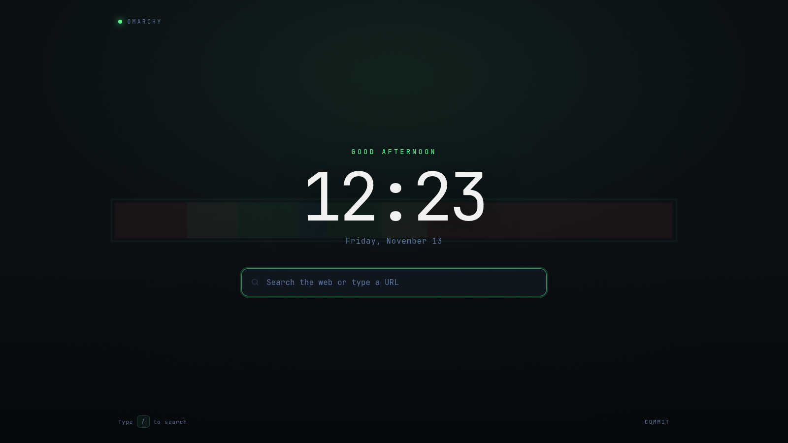

# Omarchy New Tab

A minimal, theme-aware new tab page for Chromium-based browsers, packaged as
an Omarchy shell service plugin. It shows a clock, greeting, date, and a search
field over your current wallpaper, and follows the active Omarchy palette.



## Requirements

- Omarchy with the Omarchy shell (Quattro or newer).
- **Chromium**, **Helium**, or **Brave** as the default web browser.

Firefox, Zen, and LibreWolf use a different extension format and are not
supported. Google Chrome, Microsoft Edge, and Vivaldi are also not supported
because branded Chromium builds no longer honor `--load-extension`.

## Install

```sh
omarchy plugin add https://github.com/icameheretodance/omarchy-newtab.git --enable
```

When the shell loads the service, it:

1. Detects the default browser with `xdg-settings`.
2. Adds this plugin's extension folder to that browser's startup flags,
   preserving every other flag and `--load-extension` path.
3. Sends a desktop notification asking you to restart the browser.
4. Generates `colors.css` and a wallpaper copy from the active theme.

Restart the browser once so it picks up the extension. If the default browser
is not supported, nothing is changed and a one-time notification explains why.
The plugin checks again on the next shell start, so it starts working after you
switch to a supported default browser.

### Manual install

The extension lives at
`~/.config/omarchy/plugins/dance.newtab/extension/browser`. For Chromium, Helium, or
Brave, append it to the existing `--load-extension` value in the matching file:

- `~/.config/chromium-flags.conf`
- `~/.config/helium-browser-flags.conf`
- `~/.config/brave-flags.conf`

```ini
--load-extension=/usr/share/omarchy-webapp-theme/extension,/home/you/.config/omarchy/plugins/dance.newtab/extension/browser
```

Commas separate extension paths. Quit the browser completely before restarting
it, otherwise the old process keeps the old flags.

## What it changes

| Path | Change |
| --- | --- |
| `~/.config/chromium-flags.conf` | Adds/removes only this extension's path |
| `~/.config/helium-browser-flags.conf` | Adds/removes only this extension's path |
| `~/.config/brave-flags.conf` | Adds/removes only this extension's path |
| `.../extension/browser/colors.css` | Generated palette (untracked) |
| `.../extension/browser/background-*` | Wallpaper copy (untracked) |
| `.../extension/browser/.theme-fingerprint` | Sync bookkeeping (untracked) |

Each flags-file edit creates a timestamped backup next to it
(`<file>.bak.<timestamp>`) and never touches other flags. If the browser is
running, it must be restarted for the change to apply.

The extension requests only the `search` permission. It has no host
permissions, makes no analytics or network requests of its own, and sends
searches through the browser's own search provider. The service only reads
local Omarchy theme files.

### Dependencies and privileges

- Bash plus standard Arch userland tools: `xdg-settings`/`xdg-mime`
  (`xdg-utils`), `pgrep` (`procps-ng`), coreutils, `sed`, and `grep`.
- `omarchy-notification-send` for notifications, with `notify-send` as a
  fallback.
- Everything runs as your user. There is no root, sudo, network access, or
  remote build step.
- No second Quickshell process is started; the service runs inside
  `omarchy-shell`.
- The installer writes only the flags files and generated extension assets
  listed above.

## How it works

- `Service.qml` runs `scripts/install` at load, then watches `theme.name`,
  `theme/colors.toml`, and the `background` symlink.
- `scripts/sync-theme` renders the palette and copies the wallpaper into the
  extension. A fingerprint guard makes repeat runs cheap. The wallpaper file
  name is content-addressed.
- The page re-fetches `colors.css` every 30 seconds while it is visible, so an
  already-open new tab picks up theme changes. Theme-set changes arrive through
  the file watcher; a 60-second check also catches wallpaper-only changes.
- Only the default browser is configured automatically. If you change the
  default while the shell is running, disable and re-enable the plugin, or run
  `~/.config/omarchy/plugins/dance.newtab/scripts/install` yourself.

## Uninstall

Run the uninstall script before removing or disabling the plugin; disabling the
shell plugin alone leaves the browser flag behind:

```sh
~/.config/omarchy/plugins/dance.newtab/scripts/uninstall
omarchy plugin remove dance.newtab
```

The uninstall script removes only this extension's path from all three flags
files (and creates backups). Restart the browser to finish.

If the plugin folder was already deleted, remove the extension path manually
from the flags files listed above.

## Troubleshooting

- **Nothing happened:** confirm `xdg-settings get default-web-browser` reports
  `chromium.desktop`, `helium.desktop`, or `brave.desktop`, then re-enable the
  plugin.
- **Browser still shows its own new tab:** quit every browser window and
  background process, then reopen. Verify the flag in the matching
  `*-flags.conf` and check `chromium://extensions` (or the browser's equivalent)
  for load errors.
- **Another new tab extension wins:** Chromium allows one new tab override.
  Remove any older new tab extension path from the flags file.
- **Theme did not update:** run
  `~/.config/omarchy/plugins/dance.newtab/scripts/sync-theme`, then reload the
  new tab. Themes with unreadable or missing `colors.toml` fall back to the
  bundled palette.
- **Plugin refuses the install path:** the extension path must not contain
  spaces or commas because they are flag and list separators. Move the plugin
  directory to a path without them.

## License

MIT. See [LICENSE](LICENSE).